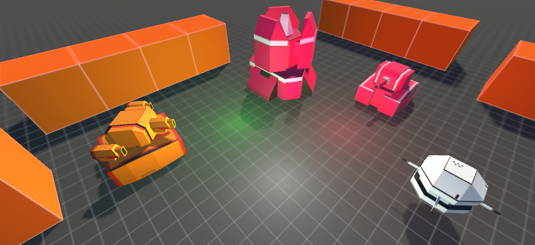
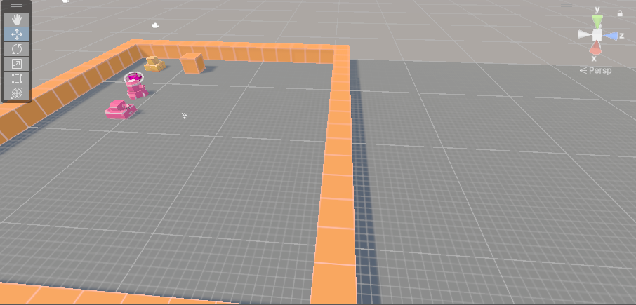

# 坦克大战 · Unity 3D 练习项目

> Unity 2023.2 做的 3D 坦克对战小游戏：驾驶坦克消灭敌人、抵达终点通关，带排行榜与设置存档。

## 玩法

- `W` / `S`（或上下方向键）：前进、后退
- `A` / `D`（或左右方向键）：车身转向
- 鼠标左右移动：转动炮塔
- 鼠标左键：开火
- 沿途消灭敌人坦克，开到最后面的终点即可通关；血量归零则失败
- 通关后可录入名字，成绩按用时排序存进排行榜（本地保存）

| 开始界面 | 战斗画面 |
|:---:|:---:|
|  |  |

## 核心实现

| 模块 | 位置 | 说明 |
|---|---|---|
| 坦克基类 | `Assets/Scripts/实践小项目/Game/GameScritpt/Object/TankBaseObj.cs` | 攻击 / 防御 / 血量 / 移动与转向速度，`Fire()` 与 `Wound()` 作为模板方法交给子类实现 |
| 玩家控制 | `Assets/Scripts/实践小项目/Game/GameScritpt/Object/PlayerObj.cs` | 键盘驱动前后移动与车身转向，鼠标控制炮塔朝向，左键开火，死亡时弹出失败面板 |
| 敌人 AI | `Assets/Scripts/实践小项目/Game/GameScritpt/Object/MonsterObj.cs` | 在多个巡逻点之间随机移动，玩家进入射程后炮塔转向并定时开火，头顶用纹理绘制血条 |
| 武器与子弹 | `Assets/Scripts/实践小项目/Game/GameScritpt/Weapon/WeaponObj.cs`、`BulletObj.cs` | 武器的射速 / 伤害配置，子弹飞行与命中判定 |
| 自定义 GUI | `Assets/Scripts/实践小项目/CustomGUI/` | 基于 `OnGUI` 自写的轻量 UI 框架：`CustomGUIRoot` 遍历子控件统一绘制，提供 Label / Button / Slider / Toggle / Input / ToggleGroup |
| 游戏数据 | `Assets/Scripts/实践小项目/Game/Data/GameDataMgr.cs` | 单例持有音乐设置与排行榜数据，排行榜按通关用时排序并只保留前 10 条 |
| 存档 | `Assets/Scripts/实践小项目/PlayerPrefsDataMgr/PlayerPrefsDataMgr.cs` | 基于 `PlayerPrefs` + 反射的通用存取，修改数据结构不用改读写代码 |
| 场景与流程 | `Assets/Scripts/场景切换和游戏退出/`、`Assets/Scripts/实践小项目/Game/GameScritpt/Object/EndPoint.cs` | 开始场景与战斗场景切换；玩家进入终点触发器时 `OnTriggerEnter` 弹出通关面板 |

## 技术点

- 用继承抽象坦克行为：`TankBaseObj` 定义受伤、死亡的模板流程，玩家与敌人坦克各自实现细节
- 不使用 UGUI，**手写 IMGUI 控件框架**，理解 `OnGUI` 的绘制顺序与布局计算
- **PlayerPrefs + 反射**做通用数据存取，换存档结构不用改存取代码
- 委托与随机数：巡逻点随机、事件回调
- 排行榜按通关用时排序，只保留前 10 名

## 如何运行

1. 用 Unity Hub 添加本目录，编辑器版本选 **2023.2.20f1c1**
2. 首次打开会自动还原 `Packages/manifest.json` 里的依赖
3. 打开 `Assets/Scenes/BeginScene.unity`，点击运行

## 关于素材

`Assets/ArtRes/` 是第三方美术与字体资源（坦克模型、音效、PSD 源文件、字体等），**未纳入本仓库**。clone 后需要自行准备，否则预制体上的贴图、音效会丢失。

## 目录

- `Assets/Scripts/实践小项目/`：主体逻辑（Game 玩法、CustomGUI 界面框架、Data 数据）
- `Assets/Scripts/场景切换和游戏退出/`、`鼠标隐藏锁定相关/`、`Unity自带随机数和委托/`：分知识点的小练习
- `Assets/Prefabs/`：预制体
- `Assets/Scenes/`：场景
- `Assets/Screenshots/`：截图
